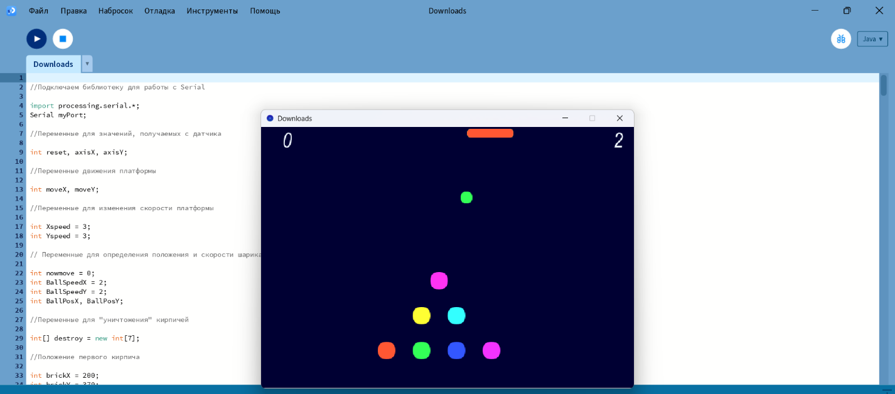
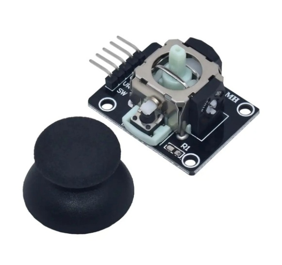
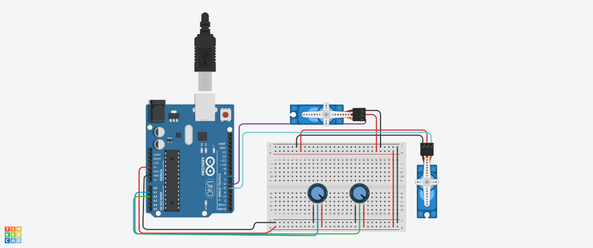
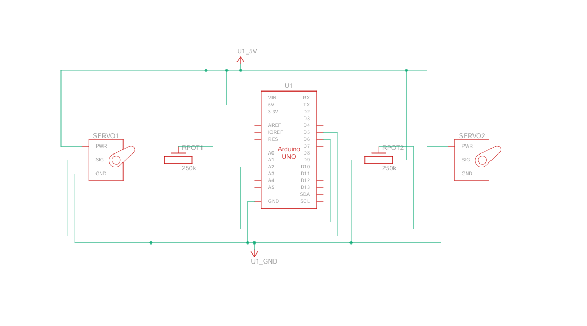
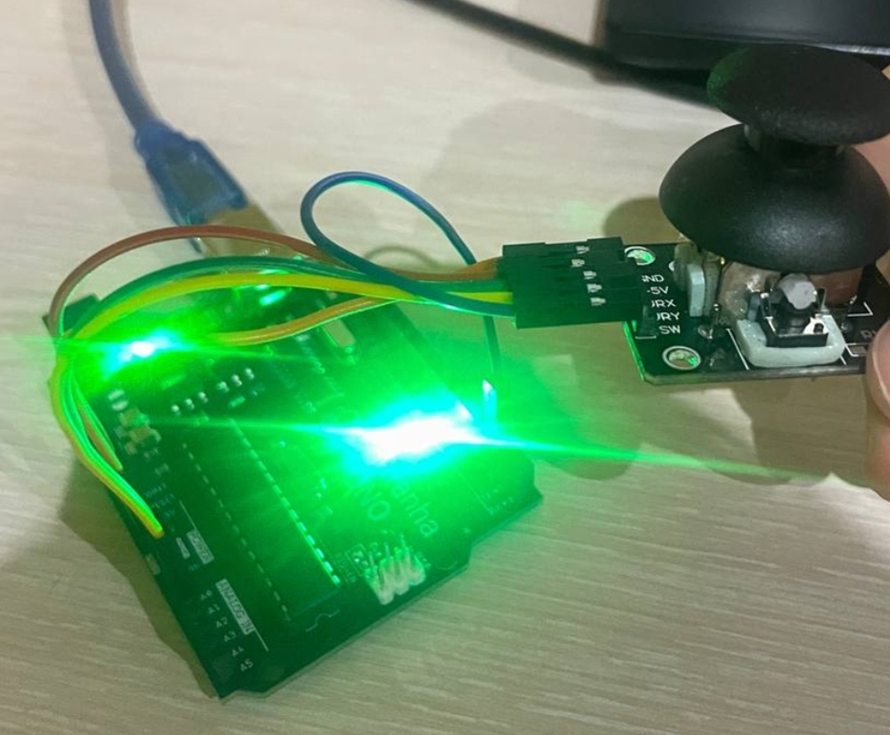
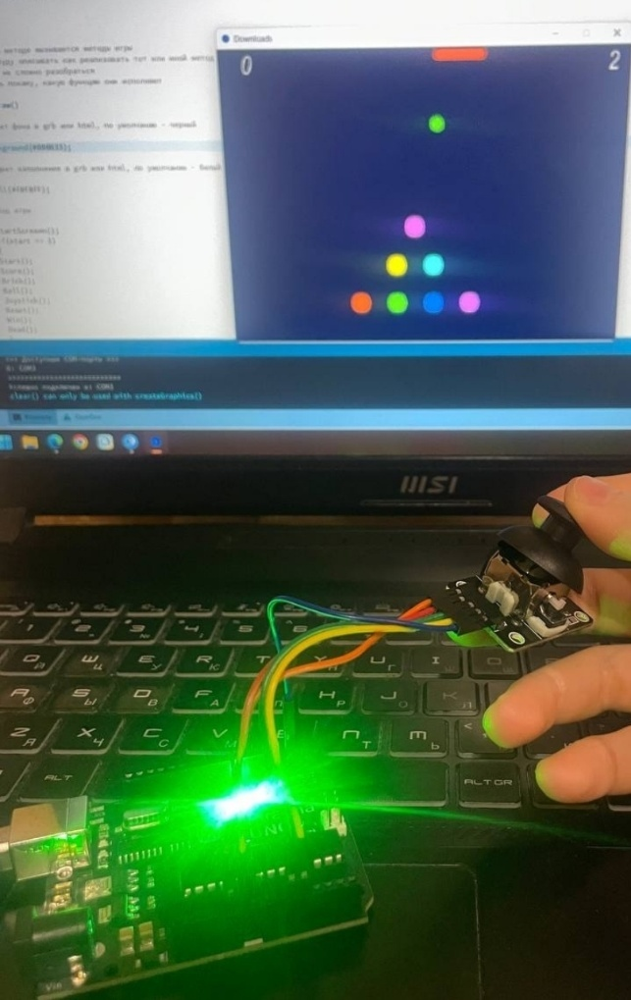
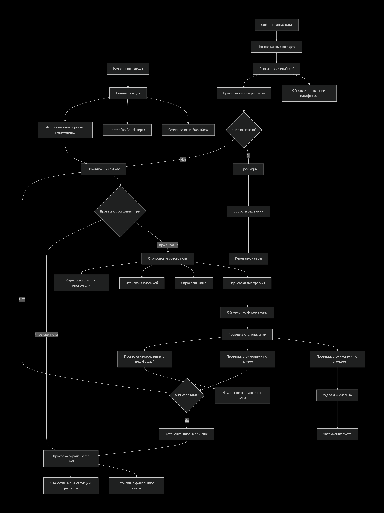

# Интерактивная игровая система на Arduino

Проект демонстрирует построение канала связи между аппаратным устройством ввода и ПК: обработка аналогового сигнала на Arduino, передача данных по Serial-протоколу, приём и интерпретация в среде Processing 4 в реальном времени. В качестве прикладного кейса реализована аркадная игра Breakout с управлением через 2-осевой джойстик.

## About

Учебный проект, выполненный в рамках практики по курсу «Основы робототехники» 

<p align="center">
  
</p>

## Структура репозитория

```
.
├── arduino/
│   └── joystick_controller/
│       └── joystick_controller.ino   # прошивка контроллера (считывание осей джойстика)
├── processing/
│   └── breakout_game/
│       └── breakout_game.pde         # игровая логика и графика (Breakout)
├── docs/
│   └── images/                       # иллюстрации из отчёта (схемы, фото сборки, скриншот игры)
└── README.md
```

## Содержание

- [Описание проекта](#описание-проекта)
- [Используемые компоненты](#используемые-компоненты)
- [Схема подключения](#схема-подключения)
- [Структура репозитория](#структура-репозитория)
- [Установка и запуск](#установка-и-запуск)
- [Алгоритм работы](#алгоритм-работы)
- [Источники](#источники)
  
## Описание проекта

**Цель:** создание интерактивной игровой системы, демонстрирующей интеграцию физического ввода (джойстик-модуля) с виртуальной игровой средой.

**Задачи**

1. Работа с аналоговым сигналом и АЦП (обработка потенциометров джойстика);
2. Последовательный протокол связи между двумя независимо работающими средами (Arduino - Processing)
3. Синхронизация "железа" с виртуальной логикой в реальном времени (game loop + serialEvent);
4. Симуляция схемы (Tinkercad), сборка, тестирование.

Связь между платой Arduino и ПК осуществляется по последовательному порту (USB) на скорости 9600 бод: Arduino считывает аналоговые значения с осей X/Y джойстика и передаёт их в виде строки `Y,X,reset`, которую принимает и обрабатывает скетч Processing.

## Используемые компоненты

| Компонент | Кол-во | Назначение |
|---|---|---|
| Arduino UNO | 1 | Центральный контроллер |
| Модуль 2-осевого джойстика KY-023 / HW-504 | 1 | Устройство физического ввода |
| Соединительные провода | 5 | Монтаж без пайки |
| USB-кабель A-B | 1 | Питание и передача данных |

<p align="center">
  

Джойстик подключается напрямую к плате: `VRx → A0`, `VRy → A1`, `+5V → 5V`, `GND → GND`.

## Схема подключения

Поскольку модуль джойстика отсутствует в библиотеке Tinkercad, для симуляции в Tinkercad используется эквивалентная схема с двумя потенциометрами и двумя сервоприводами — она воспроизводит те же физические принципы обработки аналогового сигнала по осям X и Y.

<p align="center">
  
</p>
<p align="center">
  
</p>

Обозначения на принципиальной схеме: `U1` — центральный контроллер, `SERVO1`/`SERVO2` — сервоприводы (аналог осей джойстика), `Rpot1`/`Rpot2` — потенциометры.

<p align="center">
  
  
</p>

## Установка и запуск

1. **Прошивка контроллера**
   - Открыть `arduino/joystick_controller/joystick_controller.ino` в Arduino IDE.
   - Подключение джойстика по схеме выше, выберите плату Arduino UNO и нужный COM-порт.
   - Загрузка скетч на плату.

2. **Запуск игры**
   - Открыть `processing/breakout_game/breakout_game.pde` в Processing 4.
   - Убедиться, что Arduino подключена по USB (скетч автоматически использует первый доступный COM-порт — см. вывод в консоли Processing).
   - Запустить скетч (`Run`). При старте нажать указанную клавишу/действие, чтобы начать игру.
   - Управлять платформой, наклоняя джойстик по осям X/Y - задача разбить все кирпичи мячиком.

## Алгоритм работы

Общая логика работы системы (опрос джойстика - передача по Serial - обновление игрового состояния - отрисовка) показана на блок-схеме:

<p align="center">
  
</p>

## Источники

1. Монк С. *Практическая электроника: иллюстрированное руководство для радиолюбителей*. — М.: ООО «И.Д. Вильямс», 2018. — 352 с.
2. Блюм Д. *Изучаем Arduino: инструменты и методы технического волшебства*. — СПб.: БХВ-Петербург, 2016. — 336 с.
3. [Онлайн-справочник по Processing](https://wikihandbk.com/wiki/Processing:Содержание)
системах».
